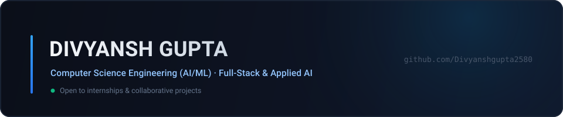
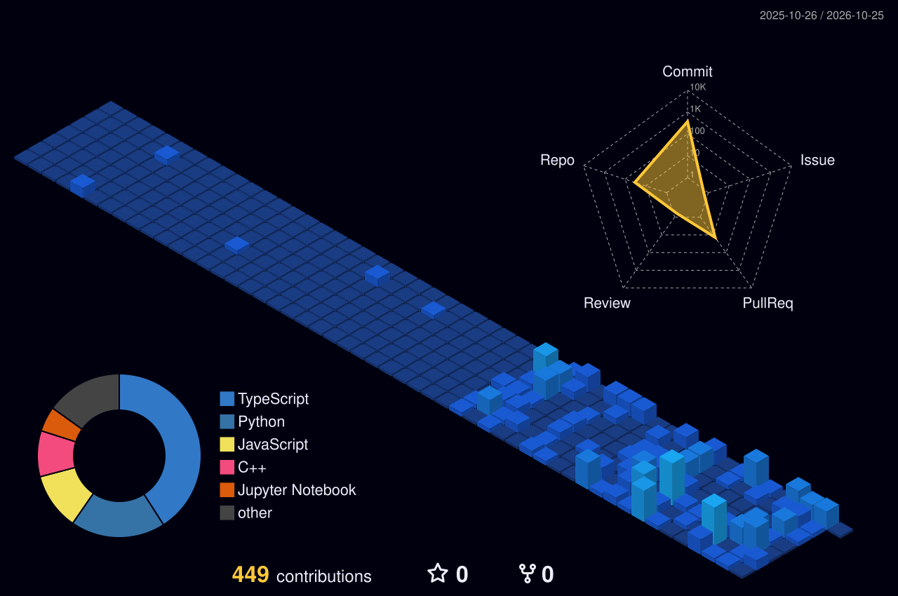

<div align="center">
  
</div>

I'm a second-year Computer Science Engineering student specializing in **AI/ML**. I build full-stack applications and practical AI systems — autonomous agents, retrieval-augmented generation, and the backend and data layers that keep them dependable. My current focus is AI engineering, clean software design, and strengthening my data structures and algorithms fundamentals. I build in public and contribute to collaborative repositories.

<p align="center">
  <a href="#projects">Projects</a> &nbsp;·&nbsp;
  <a href="#skills">Skills</a> &nbsp;·&nbsp;
  <a href="#activity">Activity</a> &nbsp;·&nbsp;
  <a href="#contact">Contact</a>
</p>

---

## Projects

### [BenefitOS](https://github.com/Divyanshgupta2580/BenifitOS_FINAL) · [Live demo](https://benifitos-final.onrender.com/)

Public welfare schemes are scattered across departments, so eligible citizens miss support. BenefitOS evaluates eligibility deterministically, tracks document readiness, and adds a bilingual AI copilot for welfare guidance.

`TypeScript` `React` `NestJS` `PostgreSQL` `Prisma` `Gemini API`

### [RevenueOS](https://github.com/Divyanshgupta2580/RevenueOS) · [Live demo](https://revenue-os-woad.vercel.app/)

Failed payments are usually retried blindly, burning gateway fees on declines that cannot recover. RevenueOS scores recoverability, lets Gemini propose a bounded recovery action, and gates every action through a deterministic policy engine with an immutable decision ledger.

`Next.js` `Django` `MongoDB` `Gemini API` `Razorpay`

### [TRON](https://github.com/Divyanshgupta2580/Tron)

Autonomous agents tend to call an LLM on every request and republish the same story. TRON separates reads from writes: a scheduled worker discovers and scores news, deduplicates it semantically, and stores the result so the feed API stays a fast database read.

`Python` `FastAPI` `SQLite` `LLM APIs`

### [JanSetu Multiverse](https://github.com/PRIYANKA-NEGI-28/JANSETU-MULTIVERSE) · *team project*

Civic complaints get lost or duplicated across departments. JanSetu Multiverse links a web dashboard, an Expo mobile app, and IoT edge sensors to detect civic issues, group duplicate reports, and route them to the right department.

`React` `Express` `Firebase` `Expo` `Arduino / Python`

---

## Skills

- **Languages** — C++, Python, JavaScript, TypeScript
- **Frontend** — HTML, CSS, React
- **Backend** — Node.js, Express
- **Databases** — MongoDB, Neo4j
- **AI / ML** — Retrieval-Augmented Generation (RAG), AI agents
- **Tools** — Git, GitHub, Vercel

---

## Problem Solving

Data structures and algorithms in C++, practiced on [LeetCode](https://leetcode.com/u/DIVYANSHGUPTA2580/) and [Codeforces](https://codeforces.com/profile/Divyansh_Gupta2007).

---

## Activity

<picture>
  <source media="(prefers-color-scheme: dark)" srcset="profile-3d-contrib/profile-night-view.svg" />
  <source media="(prefers-color-scheme: light)" srcset="profile-3d-contrib/profile-green.svg" />
  
</picture>

<details>
<summary>Coding activity — WakaTime</summary>

<!--START_SECTION:waka-->

```txt
Coding Activity:
Today:          0 secs
This Month:     45 hrs 50 mins
This Year:      74 hrs 41 mins (All Time: 82 hrs 35 mins)

Languages:
TypeScript     6 hrs 51 mins ██████████░░░░░░░░░░░░░░░   38.36 %
JavaScript     4 hrs 50 mins ███████░░░░░░░░░░░░░░░░░░   27.04 %
Markdown       1 hr 47 mins  ██░░░░░░░░░░░░░░░░░░░░░░░   09.97 %
JSON           1 hr 13 mins  ██░░░░░░░░░░░░░░░░░░░░░░░   06.84 %
CSS            45 mins       █░░░░░░░░░░░░░░░░░░░░░░░░   04.27 %
Git Config     26 mins       █░░░░░░░░░░░░░░░░░░░░░░░░   02.49 %
```

<!--END_SECTION:waka-->

</details>

---

## Contact

- **Portfolio** — [divyansh-gupta-portfolio-lac.vercel.app](https://divyansh-gupta-portfolio-lac.vercel.app/)
- **Email** — [inbox.DivyanshGupta1@protonmail.com](mailto:inbox.DivyanshGupta1@protonmail.com)
- **LinkedIn** — [divyanshgupta2007](https://www.linkedin.com/in/divyanshgupta2007/)
- **GitHub** — [Divyanshgupta2580](https://github.com/Divyanshgupta2580)
- **X** — [@DivyanshGu19605](https://x.com/DivyanshGu19605)
