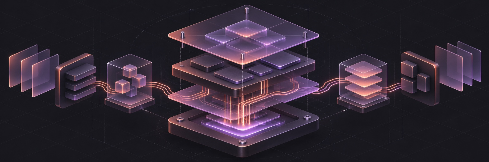
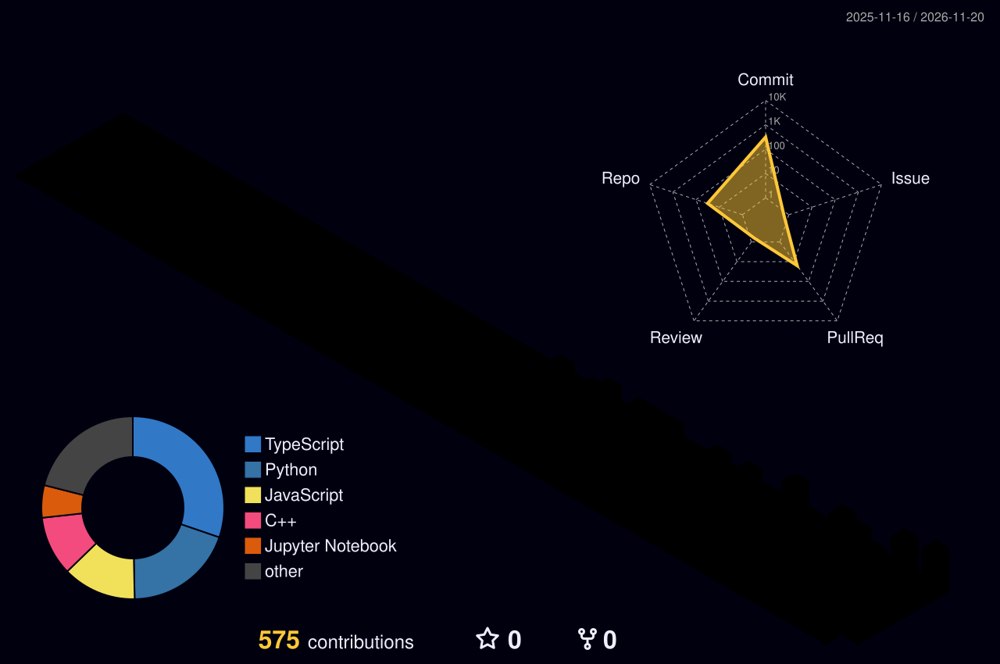

# Divyansh Gupta

  

  &emsp;
  &emsp;
  &emsp;
  &emsp;
  

## Selected Projects

<table>
  <tr>
    <td width="50%" valign="top">
      <h3>BenefitOS</h3>
      
Citizens enter profile and income details to find government welfare schemes whose eligibility rules match their situation. A document vault uses OCR to extract information from uploaded paperwork and helps users organize the documents they need to apply.

      
<strong>Technology used</strong> <code>React</code> <code>NestJS</code> <code>Prisma</code> <code>PostgreSQL</code> <code>Expo</code>

      
<strong>Live demo</strong> · <a href="https://benifit-os.onrender.com/">Open BenefitOS</a> 
      <strong>Source code</strong> · Private

    </td>
    <td width="50%" valign="top">
      <h3>RevenueOS</h3>
      
RevenueOS scores failed payments and estimates their recovery value. Gemini suggests whether to retry, send a payment link or reminder, or stop. A policy engine checks the recommendation against retry limits and risk rules, then records the decision in an audit ledger.

      
<strong>Technology used</strong> <code>Next.js</code> <code>Django</code> <code>MongoDB</code> <code>Gemini API</code>

      
<strong>Live demo</strong> · <a href="https://revenue-os-woad.vercel.app/">Open RevenueOS</a>

    </td>
  </tr>
  <tr>
    <td width="50%" valign="top">
      <h3>Hirable</h3>
      
Hirable reviews a student’s résumé for applicant tracking system (ATS) compatibility and evaluates their developer profile. Students can practice mock interviews by voice or text, find job openings, and use a Kanban board to track applications and follow-up dates.

      
<strong>Technology used</strong> <code>Next.js</code> <code>FastAPI</code> <code>Supabase</code> <code>LiveKit</code>

      
<strong>Live demo</strong> · <a href="https://placement-readiness-copilot.vercel.app/">Open Hirable</a>

    </td>
    <td width="50%" valign="top">
      <h3>JeeVika</h3>
      
This healthcare workflow prototype connects multilingual patient check-in on kiosks and mobile devices with clinician workspaces. Intake information follows the patient through care handoffs, with dedicated views for staff to manage queues and coordinate follow-up.

      
<strong>Technology used</strong> <code>React</code> <code>TypeScript</code> <code>Hono</code> <code>Flutter</code> <code>Dart</code>

      
<strong>Live demo</strong> · No public demo verified

    </td>
  </tr>
</table>

## Areas of Focus

- **Full-stack development** — Build complete web and mobile workflows, from the interface to persistence.
- **Backend and API engineering** — Design APIs with clear service boundaries, validation, and data models.
- **Applied AI systems** — Put model outputs to work inside applications with explicit checks before actions.
- **RAG and AI agents** — Retrieve evidence from documents, ground answers in that evidence, and give agents tools for defined tasks.

## Technical Skills

### Languages

### Web and Mobile

### APIs and Data

  
  

### AI and Delivery

  
  

## Activity and Coding

### GitHub

<picture>
  <source media="(prefers-color-scheme: light)" srcset="https://raw.githubusercontent.com/Divyanshgupta2580/Divyanshgupta2580/output/github-contribution-grid-snake.svg">
  
</picture>

### WakaTime by Language

Measured time takes priority. If a longer range is unavailable, the labeled estimate uses the latest tracked week’s daily average.

<!--START_SECTION:waka-->

#### Weekly · 7 days

<!--START_SECTION:waka-last_7_days-->

_Waiting for tracked language totals._

<!--END_SECTION:waka-last_7_days-->

#### Monthly · 30 days

<!--START_SECTION:waka-last_30_days-->

_Waiting for monthly totals or a tracked week to estimate from._

<!--END_SECTION:waka-last_30_days-->

#### Yearly · 12 months

<!--START_SECTION:waka-last_year-->

_Waiting for yearly totals or a tracked week to estimate from._

<!--END_SECTION:waka-last_year-->

<!--END_SECTION:waka-->

### Problem Solving

#### LeetCode · [DIVYANSHGUPTA2580](https://leetcode.com/u/DIVYANSHGUPTA2580/)

#### Codeforces · [Divyansh_Gupta2007](https://codeforces.com/profile/Divyansh_Gupta2007)

