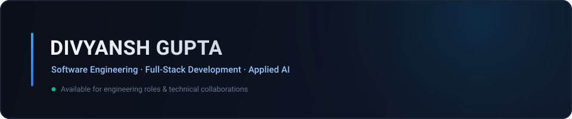

<div align="center">




**Software engineering · Full-stack development · Applied AI**

Building reliable applications and practical AI systems — from backend architecture and data design to autonomous agents and retrieval-augmented generation.

[Portfolio](https://divyansh-gupta-portfolio-lac.vercel.app/) &nbsp;·&nbsp;
[LinkedIn](https://www.linkedin.com/in/divyanshgupta2007/) &nbsp;·&nbsp;
[GitHub](https://github.com/Divyanshgupta2580) &nbsp;·&nbsp;
[Email](mailto:inbox.DivyanshGupta1@protonmail.com)

</div>

---

## Selected Projects

A selection of software systems built to solve practical problems.

<table>
  <tr>
    <td width="50%" valign="top">
      <h3><a href="https://github.com/Divyanshgupta2580/BenefitOSFINAL">BenefitOS</a></h3>
      <sub>CIVIC TECHNOLOGY · FULL-STACK</sub>
      <p>A platform that helps citizens discover government schemes, evaluate eligibility, and prepare the documentation needed for applications.</p>
      <p><code>TypeScript</code> <code>React</code> <code>Node.js</code> <code>Neo4j</code></p>
      <p><a href="https://github.com/Divyanshgupta2580/BenefitOSFINAL">Repository ↗</a> &nbsp;·&nbsp; <a href="https://benifit-os.onrender.com/">Live demo ↗</a></p>
    </td>
    <td width="50%" valign="top">
      <h3><a href="https://github.com/Divyanshgupta2580/Tron">TRON</a></h3>
      <sub>AUTONOMOUS AI · NEWS INTELLIGENCE</sub>
      <p>An autonomous agent that discovers topics, evaluates news against defined criteria, removes duplicate stories, and publishes relevant updates through scheduled workflows.</p>
      <p><code>Python</code> <code>FastAPI</code> <code>SQLite</code> <code>LLM APIs</code></p>
      <p><a href="https://github.com/Divyanshgupta2580/Tron">Repository ↗</a></p>
    </td>
  </tr>
  <tr>
    <td width="50%" valign="top">
      <h3><a href="https://github.com/Divyanshgupta2580/RevenueOS">RevenueOS</a></h3>
      <sub>FINTECH · AI DECISION SYSTEMS</sub>
      <p>A payment-recovery decision system that evaluates failed transactions, assesses recoverability, and controls recovery decisions through a deterministic policy engine.</p>
      <p><code>Next.js</code> <code>Django</code> <code>MongoDB</code> <code>Gemini API</code></p>
      <p><a href="https://github.com/Divyanshgupta2580/RevenueOS">Repository ↗</a> &nbsp;·&nbsp; <a href="https://revenue-os-woad.vercel.app/">Live demo ↗</a></p>
    </td>
    <td width="50%" valign="top">
      <h3><a href="https://github.com/PRIYANKA-NEGI-28/JANSETU-MULTIVERSE">JanSetu Multiverse</a></h3>
      <sub>SMART INFRASTRUCTURE · CIVIC TECHNOLOGY</sub>
      <p>A collaborative civic-infrastructure project focused on identifying streetlight failures, analyzing reported issues, and supporting more efficient maintenance.</p>
      <p><code>Python</code> <code>OpenCV</code> <code>YOLO</code> <code>Edge AI</code></p>
      <p><a href="https://github.com/PRIYANKA-NEGI-28/JANSETU-MULTIVERSE">Repository ↗</a></p>
    </td>
  </tr>
</table>

---

## Technical Skills

<table>
  <tr>
    <td width="33%" valign="top">
      <strong>Languages</strong><br><br>
      <code>C++</code> <code>Python</code> <code>JavaScript</code> <code>TypeScript</code>
    </td>
    <td width="33%" valign="top">
      <strong>Frontend</strong><br><br>
      <code>HTML</code> <code>CSS</code> <code>React</code>
    </td>
    <td width="34%" valign="top">
      <strong>Backend</strong><br><br>
      <code>Node.js</code> <code>Express.js</code>
    </td>
  </tr>
  <tr>
    <td valign="top">
      <strong>Databases</strong><br><br>
      <code>MongoDB</code> <code>Neo4j</code>
    </td>
    <td valign="top">
      <strong>AI Systems</strong><br><br>
      <code>RAG</code> <code>AI Agents</code>
    </td>
    <td valign="top">
      <strong>Tools</strong><br><br>
      <code>Git</code> <code>GitHub</code> <code>Vercel</code>
    </td>
  </tr>
</table>

---

## Areas of Focus

- **Full-stack engineering** — modular web applications, maintainable components, and type-safe development.
- **Backend architecture** — REST APIs, service boundaries, validation, and reliable data flows.
- **Applied AI** — retrieval-augmented generation, autonomous agents, and structured tool workflows.
- **Data and algorithms** — database modelling, problem-solving patterns, and algorithmic fundamentals in C++.

---

## GitHub Activity

<p align="center">
  <picture>
    <source media="(prefers-color-scheme: dark)" srcset="https://raw.githubusercontent.com/Divyanshgupta2580/Divyanshgupta2580/output/github-contribution-grid-snake-dark.svg" />
    <source media="(prefers-color-scheme: light)" srcset="https://raw.githubusercontent.com/Divyanshgupta2580/Divyanshgupta2580/output/github-contribution-grid-snake.svg" />
    
  </picture>
</p>

---

## Coding Activity

<details>
  <summary>WakaTime coding statistics</summary>

  <!--START_SECTION:waka-->

```txt
Coding Activity:
Today:          0 mins
```

<!--END_SECTION:waka-->

</details>

---

## Problem Solving

Practice and profiles:

[LeetCode](https://leetcode.com/u/DIVYANSHGUPTA2580/) &nbsp;·&nbsp;
[Codeforces](https://codeforces.com/profile/Divyansh_Gupta2007) &nbsp;·&nbsp;
[CodeChef](https://www.codechef.com/users/divyansh2007)

---

## Contact

| Platform | Link |
|:--|:--|
| Portfolio | [divyansh-gupta-portfolio-lac.vercel.app](https://divyansh-gupta-portfolio-lac.vercel.app/) |
| Email | [inbox.DivyanshGupta1@protonmail.com](mailto:inbox.DivyanshGupta1@protonmail.com) |
| LinkedIn | [linkedin.com/in/divyanshgupta2007](https://www.linkedin.com/in/divyanshgupta2007/) |
| GitHub | [github.com/Divyanshgupta2580](https://github.com/Divyanshgupta2580) |
| X | [@DivyanshGu19605](https://x.com/DivyanshGu19605) |

---

<sub>Designed to stay readable, lightweight, and compatible with GitHub's README renderer.</sub>
